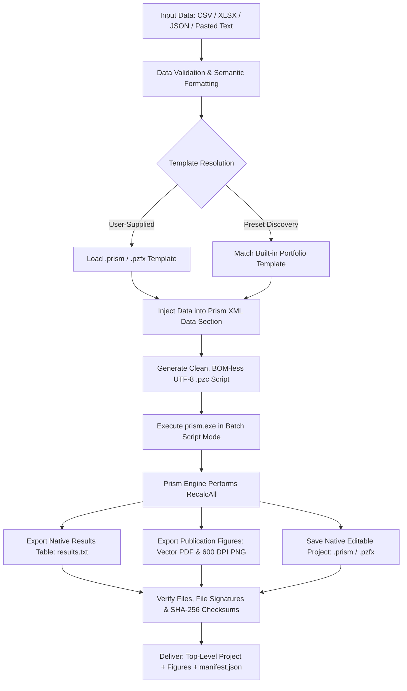

# Prism Plot Skill 📊

<p align="center">
  <strong>Native GraphPad Prism Automation Skill for Scientific Plotting, Dynamic Statistical Recalculation, and Publication-Quality Figure Export.</strong>
</p>

<p align="center">
  <a href="README.md"><strong>English</strong></a> •
  <a href="README_zh.md">简体中文</a>
</p>

<p align="center">
  
  
  
  
  
</p>

---

## 📖 Overview

`prism-plot` is an autonomous agent skill tailored for AI coding assistants (Claude Code, OpenAI Codex, Antigravity, etc.) and biomedical/life-science researchers.

**No mock plotting or fabricated statistics**: Instead of substituting Prism with external libraries (e.g., Matplotlib or Seaborn) or slapping static text asterisks onto cropped images, `prism-plot` drives your local **Windows installation of GraphPad Prism** via native `.pzc` script execution and XML data pipelines. It triggers Prism's genuine statistical engine (`RecalcAll`), dynamically recalculates tests (e.g., Welch's t-test, ANOVA) and pairwise comparison brackets, and delivers **fully editable `.prism` / `.pzfx` project files** alongside publication-ready vector PDFs and high-resolution raster images.

---

## 🌟 Key Features

- 🎯 **Native Prism Engine Execution**: Executes genuine batch `.pzc` commands against your local Prism binary—never fakes or simulates outputs.
- 🔬 **True Native Statistics & Significance**: Leverages Prism's internal calculation pipeline. Significance asterisks and brackets are linked to live analyses (`Pairwise Comparisons`) and update dynamically upon recalculation. Exports raw `results.txt` tabular statistics.
- 📊 **Multi-Format Tabular Input**: Directly parses CSV, TSV, Excel (`.xlsx`), JSON, or user-pasted table records with missing value validation.
- 📐 **Semantic Scientific Layouts**: Supports standard scientific data schemas:
  - `column`: Independent biological/experimental replicates across categorical groups.
  - `xy`: Numerical time-courses, dose-response curves, and concentration gradients.
- 🎨 **Publication-Grade Styling & Exports**:
  - Native color scheme presets (`Floral`, `Colorblind Safe`, `Waves`).
  - Axis range overrides (`--x-min/max`, `--y-min/max`) and major tick intervals (`--x/y-interval`).
  - Exports vector PDF, SVG, EPS, EMF, and 100–1200 DPI TIFF/PNG.
- 💾 **Deliverable-First Project Management**: Automatically saves a top-level, double-clickable project file (`<dataset>-<timestamp>.prism`) with SHA-256 checksums and an audited `manifest.json`.

---

## 🏗️ Architecture & Workflow



---

## 🚀 Quick Start

### 1. Ask Your Agent to Install the Skill

```text
Install the prism-plot skill from https://github.com/Achuan-2/prism-plot
```

### 2. Prerequisites

- **OS**: Windows 10 / 11
- **GraphPad Prism**: Installed locally (Prism 10+ recommended, verified on 10.3.1; backward compatible with Prism 9 via `.pzfx`).
- **Python Runtime**: Python 3.10+ managed via [uv](https://github.com/astral-sh/uv).

### 3. Environment Doctor

Run this command from the installed skill directory to verify your local Prism installation and executable path:

```powershell
uv run python scripts/prism_plot.py doctor
```

*Tip: If Prism is installed in a non-standard directory, specify `--prism-exe "C:\Path\To\prism.exe"` or set the `PRISM_EXE` environment variable.*

---

## 💻 CLI Usage Examples

### Example 1: Column Scatter Plot with Built-in Preset

```powershell
uv run python scripts/prism_plot.py plot `
  --input "D:\data\assay.csv" `
  --layout column `
  --preset column-scatter `
  --title "Drug Response" `
  --y-title "Fluorescence (a.u.)" `
  --output "D:\figures"
```

### Example 2: Custom Template with Welch's t-Test & Results Export

Use an existing `.prism` template configured with a Welch's t-test and comparison asterisks, inject fresh data, recalculate, and export the official statistical report and figures:

```powershell
uv run python scripts/prism_plot.py plot `
  --input "D:\data\two-groups.csv" `
  --layout column `
  --template "D:\templates\welch-template.prism" `
  --graph-index 1 `
  --results-index 1 `
  --color-scheme "Floral" `
  --title "Welch's t-test" `
  --y-min 0 --y-max 160 --y-interval 40 `
  --formats pdf png `
  --dpi 600 `
  --project-format prism `
  --output "D:\figures"
```

### Example 3: Multi-Sheet Excel Input with XY Timecourse Curve

```powershell
uv run --with openpyxl python scripts/prism_plot.py plot `
  --input "D:\data\kinetics.xlsx" `
  --sheet "Kinetics_Data" `
  --layout xy `
  --preset xy-line `
  --x-title "Time (min)" `
  --y-title "Absorbance (OD600)" `
  --formats pdf png `
  --output "D:\figures"
```

### Example 4: Dry-Run / Preparation Mode (No Prism Launch)

Pre-inject data and stage `.pzc` script commands without launching the GUI process (ideal for verification or CI pipelines):

```powershell
uv run python scripts/prism_plot.py plot `
  --input "D:\data.csv" `
  --layout column `
  --template "D:\template.pzfx" `
  --prepare-only `
  --output "D:\figures"
```

---

## 🤖 AI Agent Integration

When integrated into an AI assistant (Codex, Antigravity, Claude Code), prompt the agent naturally:

```text
"Please use $prism-plot to analyze the attached experiment.csv, apply my two-group 
comparison template, export 600 DPI PNG and vector PDF, and preserve the editable .prism project."
```

The agent will automatically:
1. Validate column headers, sample counts, and data layouts.
2. Select the optimal template and inject values into the XML structure.
3. Execute Prism batch commands and wait for completion signals.
4. Read and verify `results.txt` to confirm statistical tests and p-values.
5. Provide a direct clickable link to the top-level deliverable `.prism` project.

---

## 📋 Command-Line Options

| Option | Type | Description |
| :--- | :--- | :--- |
| `--input` | Path *(Required)* | Input data path (`.csv`, `.tsv`, `.xlsx`, `.json`). |
| `--layout` | `column` \| `xy` *(Required)* | Semantic data layout (`column`: independent groups; `xy`: time-course/curves). |
| `--template` | Path | Custom Prism template (`.prism`, `.pzfx`, `.pzf`, `.pzt`). |
| `--preset` | Choice | Built-in presets: `column-scatter`, `box-whisker`, `scatter-bars`, `xy-line`. |
| `--sheet` | String | Sheet name for Excel `.xlsx` files (auto-selected if only one sheet exists). |
| `--results-index` | Integer | Export Prism Results table as `results.txt` (1-indexed). |
| `--graph-index` | Integer | Export specific Graph page (1-indexed). |
| `--project-format`| `prism` \| `pzfx` | Target project format (default: `prism` for Prism 10+; fallback: `pzfx`). |
| `--color-scheme` | String | Native Prism color scheme name (e.g. `Floral`, `Colorblind Safe`, `Waves`). |
| `--title` / `--x-title` / `--y-title` | String | Custom main title and axis titles. |
| `--x-min` / `--x-max` / `--y-min` / `--y-max` | Float | Explicit axis boundary range overrides. |
| `--x-interval` / `--y-interval` | Float | Axis major tick interval (must be > 0). |
| `--formats` | List | Export figure formats: `pdf`, `png`, `tif`, `eps`, `emf`, `svg` (default: `pdf png`). |
| `--dpi` | 100 \| 300 \| 600 \| 1200 | Raster export DPI (default: 300). |
| `--prepare-only` | Flag | Generate staged project and `.pzc` script without launching Prism. |

---

## 📁 Repository Structure

```text
prism-plot/
├── SKILL.md                     # Core skill specification and agent instructions
├── README.md                    # English documentation and usage guide
├── README_zh.md                 # 简体中文文档 (Chinese documentation)
├── agents/
│   └── openai.yaml              # Agent UI interface and default prompt definition
├── references/
│   ├── appearance.md            # Styling guidelines, color schemes, and limitations
│   ├── native-statistics.md     # Native statistics, significance, and template authoring
│   └── prism-automation.md      # Official .pzc command reference and XML schema notes
└── scripts/
    ├── prism_plot.py            # Primary Python automation orchestrator
    └── test_prism_plot.py       # Comprehensive unit and integration test suite
```

---

## 📦 Deliverables & Verification

Every execution generates an isolated batch folder and copies the primary project to the top level:

1. **Editable Project**: `<dataset>-<timestamp>.prism` (or `.pzfx`), ready for immediate editing in Prism.
2. **Publication Figures**: Native vector PDF and high-resolution PNG (300/600 DPI).
3. **Statistical Results** (optional): Plaintext tab-delimited `results.txt` directly exported by Prism.
4. **Audit Manifest**: `manifest.json`, recording SHA-256 hashes, input parameters, template metadata, and exit statuses.

---

## ⚠️ Design Philosophy & Safety Boundaries

1. **Scientific Integrity**: Python scripts never fabricate or compute p-values; all statistics are derived through Prism's native engine via `RecalcAll`.
2. **Template-Driven Aesthetics**: Geometry (font family, line weights, point radius, aspect ratio) belongs inside Prism templates. The automation script never modifies opaque binary graphics blocks.
3. **Non-Destructive Process Handling**: Never forces termination of pre-existing user Prism windows or edits system licensing files.

---

## 📄 License

Distributed under the MIT License.

*Disclaimer: GraphPad Prism is a registered trademark of Dotmatics. This project is an independent automation tool and requires a valid, licensed installation of GraphPad Prism on the host machine.*
