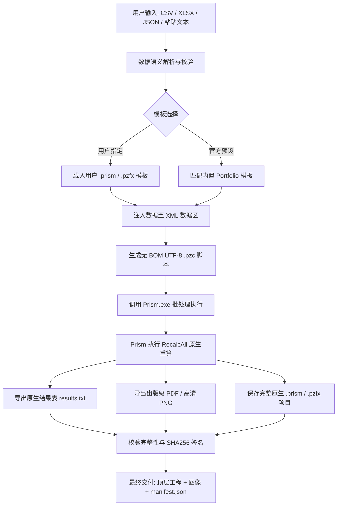

# Prism Plot Skill 📊

<p align="center">
  <strong>基于 Windows 原生 GraphPad Prism 引擎的科研绘图与统计分析自动化 Skill</strong>
</p>

<p align="center">
  <a href="README.md">English</a> •
  <a href="README_zh.md"><strong>简体中文</strong></a>
</p>

<p align="center">
  
  
  
  
  
</p>

---

## 📖 项目简介 (Overview)

`prism-plot` 是一个专为 AI Agent（如 Claude Code、Codex、Antigravity 等）和科研人员设计的自动化绘图 Skill。它**拒绝使用第三方 Python 绘图库进行平替或伪造统计结果**，而是通过驱动本地 Windows 环境下已安装的 **GraphPad Prism**（通过官方 `.pzc` 脚本与 XML 数据管道），实现真正的 **Prism 原生绘图、原生统计重算（`RecalcAll`）与出版级矢量图/高分栅格图导出**。

每次执行均会交付**完全可编辑的原生 `.prism` / `.pzfx` 项目文件**与完整的审计清单（`manifest.json`），方便研究人员直接双击进入 Prism 进行后续微调与论文排版。

---

## 🌟 核心特性 (Key Features)

- 🎯 **真实 Prism 引擎驱动**：通过本地 `.pzc` 自动化脚本驱动正版 Prism 运行，杜绝外部重绘与虚假截图。
- 🔬 **原生统计检验与关联星号**：依赖 Prism 内部进行 t 检验/方差分析等运算，通过 `RecalcAll` 触发动态 Pairwise Comparisons 显著性标注，支持原生导出 `results.txt` 统计报表。
- 📊 **多格式输入自动解析**：直接支持 CSV、TSV、Excel (`.xlsx`)、JSON 及剪贴板表格文本，智能校验数据完整性与缺失值。
- 📐 **语义布局支持**：原生适配 `column`（单因子独立观测组）与 `xy`（时间序列/浓度-响应曲线）等科学数据布局。
- 🎨 **原生样式与出版级导出**：
  - 支持 Prism 预设主题配色（如 `Floral`、`Colorblind Safe`、`Waves`）。
  - 支持自定义坐标区间（`--x-min/max`、`--y-min/max`）与主刻度间距（`--x/y-interval`）。
  - 导出出版级矢量 PDF、SVG、EPS/EMF 或 100~1200 DPI 高清 TIFF/PNG。
- 💾 **源项目完整交付**：自动生成带时间戳的顶层可双击项目副本（`<数据名>-<时间戳>.prism`），记录 SHA-256 校验和与执行参数。

---

## 🏗️ 工作流程 (Architecture & Workflow)



---

## 🚀 快速上手 (Quick Start)

### 1. 安装 Skill

安装 [Node.js](https://nodejs.org/)（包含 `npx`）后，在终端运行：

```powershell
npx skills add Achuan-2/prism-plot
```


也可以让 Agent 安装：

```text
从 https://github.com/Achuan-2/prism-plot 安装 prism-plot skill
```

### 2. 前置依赖 (Prerequisites)

- **操作系统**：Windows 10 / 11
- **软件要求**：本地已安装 **GraphPad Prism**（推荐 Prism 10+，经 Prism 10.3.1 实测；旧版本可降级使用 `.pzfx` 格式）
- **开发环境**：Python 3.10+，推荐使用 [uv](https://github.com/astral-sh/uv) 运行；读取 `.xlsx` 需安装 `openpyxl`

### 3. 环境体检 (Doctor Check)

进入安装后的 skill 目录，执行以下命令检查本地 Prism 安装状态与路径：

```powershell
uv run python scripts/prism_plot.py doctor
```

如果 Prism 未安装在标准路径，可通过 `--prism-exe` 或环境变量 `PRISM_EXE` 指定。

---

## 💻 命令行使用示例 (CLI Usage)

### 示例 1：两组柱状散点图（内置预设）

```powershell
uv run python scripts/prism_plot.py plot `
  --input "D:\data\experiment.csv" `
  --layout column `
  --preset column-scatter `
  --title "实验组与对照组比较" `
  --y-title "荧光强度 (a.u.)" `
  --output "D:\figures"
```

### 示例 2：使用自定义统计模板导出统计结果表与高清图

使用包含 Welch's t 检验及星号标注的模板，更新数据后重算并导出原生统计值：

```powershell
uv run python scripts/prism_plot.py plot `
  --input "D:\data\two-groups.csv" `
  --layout column `
  --template "D:\templates\welch-template.prism" `
  --graph-index 1 `
  --results-index 1 `
  --color-scheme "Floral" `
  --title "Welch's t-test" `
  --y-min 0 --y-max 150 --y-interval 30 `
  --formats pdf png `
  --dpi 600 `
  --project-format prism `
  --output "D:\figures"
```

### 示例 3：Excel 输入与时间课程曲线 (XY Layout)

```powershell
uv run --with openpyxl python scripts/prism_plot.py plot `
  --input "D:\data\timecourse.xlsx" `
  --sheet "Sheet1" `
  --layout xy `
  --preset xy-line `
  --x-title "Time (min)" `
  --y-title "OD600" `
  --formats pdf png `
  --output "D:\figures"
```

### 示例 4：仅准备项目与脚本（不启动 Prism 界面）

用于离线核对 XML 数据注入或在 CI 环境预检：

```powershell
uv run python scripts/prism_plot.py plot `
  --input "D:\data.csv" `
  --layout column `
  --template "D:\template.pzfx" `
  --prepare-only `
  --output "D:\figures"
```

---

## 🤖 在 AI Agent 中使用 (Agent Integration)

将本仓库作为 Skill 挂载至 Codex / Antigravity / Claude Code 后，可通过自然语言直接触发：

```text
"请使用 $prism-plot 分析附件中的 experiment.csv 数据，套用我的两组比较模板，
导出 600 dpi PNG 和矢量 PDF，保留可编辑的 .prism 项目。"
```

Agent 会自动：
1. 校验数据格式与表头合法性；
2. 匹配对应布局与模板；
3. 执行 Prism 原生脚本导出；
4. 校验生成图像与 `results.txt` 中的统计显著性；
5. 提供可直接点击的双击打开源项目路径。

---

## 📋 参数参考 (CLI Options)

| 参数 | 类型 | 说明 |
| :--- | :--- | :--- |
| `--input` | 路径 *(必填)* | 输入数据文件路径（支持 `.csv`, `.tsv`, `.xlsx`, `.json`） |
| `--layout` | `column` \| `xy` *(必填)* | 数据布局类型（`column`: 独立组；`xy`: 时间/剂量曲线） |
| `--template` | 路径 | 自定义 Prism 模板路径（支持 `.prism`, `.pzfx`, `.pzf`, `.pzt`） |
| `--preset` | 选项 | 内置模板预设：`column-scatter`, `box-whisker`, `scatter-bars`, `xy-line` |
| `--sheet` | 字符串 | Excel 工作表名称（仅单工作表时可省略） |
| `--results-index` | 整数 | 导出指定 Prism 原生统计结果表（Results Table）为 `results.txt`（序号从 1 开始） |
| `--graph-index` | 整数 | 导出指定图形页面（Graph）（序号从 1 开始） |
| `--project-format`| `prism` \| `pzfx` | 交付项目格式（默认 `prism`，需 Prism 10+；旧版可选 `pzfx`） |
| `--color-scheme` | 字符串 | 原生配色方案名称（如 `Floral`, `Colorblind Safe`, `Waves`） |
| `--title` / `--x-title` / `--y-title` | 字符串 | 自定义图表总标题及 X/Y 轴标题 |
| `--x-min` / `--x-max` / `--y-min` / `--y-max` | 数值 | 手动限定坐标轴显示范围 |
| `--x-interval` / `--y-interval` | 数值 | 设定坐标轴主刻度间距（步长） |
| `--formats` | 列表 | 导出图像格式，支持 `pdf`, `png`, `tif`, `eps`, `emf`, `svg`（默认 `pdf png`） |
| `--dpi` | 100 \| 300 \| 600 \| 1200 | 栅格图导出分辨率（默认 300） |
| `--prepare-only` | 标志 | 仅准备注入后的工程与 `.pzc` 批处理脚本，不拉起 Prism 进程 |

---

## 📁 目录组织 (Repository Structure)

```text
prism-plot/
├── SKILL.md                     # Skill 主定义与 Agent 详细执行指引
├── README.md                    # 英文说明文档 (English Documentation)
├── README_zh.md                 # 中文说明文档 (Chinese Documentation)
├── agents/
│   └── openai.yaml              # Agent UI 接口声明与默认 Prompt
├── references/
│   ├── appearance.md            # 原生图形美化、颜色方案与字体边界
│   ├── native-statistics.md     # 原生统计检验、显著性标注与模板设计指南
│   └── prism-automation.md      # 官方 .pzc 脚本指令、XML 规范与编码处理
└── scripts/
    ├── prism_plot.py            # 核心自动化调度器（标准库实现，纯净无外部重依赖）
    └── test_prism_plot.py       # 自动化单元测试与用例验证
```

---

## 📦 交付物规范 (Deliverables)

每次成功运行后，输出文件夹下会生成独立运行批次目录，并在顶层输出：
1. **可编辑工程**：`<数据名>-<运行ID>.prism`（或 `.pzfx`），可直接在 Prism 中双击打开继续编辑；
2. **出版图纸**：原生导出的高质量矢量 PDF 与高分辨率 PNG；
3. **统计报表**（可选）：Prism 官方计算并导出的 `results.txt`；
4. **审计清单**：`manifest.json`，完整记录输入哈希、使用模板、命令参数、SHA-256 校验和与执行状态。

---

## ⚠️ 能力边界与设计哲学 (Design Philosophy)

1. **绝对诚信的科学计算**：Python 脚本不参与计算 p 值或绘制星号，所有分析完全交由 Prism 的 `RecalcAll` 引擎执行；
2. **原生界面优先**：字号、线宽、点样式等图形二进制属性由模板决定；如果现有模板无法满足特定排版要求，建议在 Prism 中微调并另存为模板复用，拒绝使用外部脚本暴力篡改二进制数据；
3. **进程安全**：执行期间不强制杀掉用户已有 Prism 实例，通过独立的锁标记与等待机制确保并发安全。

---

## 📄 许可协议 (License)

本项目遵循 MIT 开源许可。
GraphPad Prism 是 Dotmatics 的注册商标。本项目为非官方自动化辅助工具，运行需用户本地自行取得合法的 GraphPad Prism 授权。
